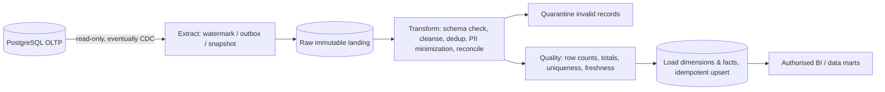

# KagoBuild: scalable, secure platform system design (v4.0)

> **Status:** **Current primary architecture** (2 Nov 2026). Supersedes the [baseline system design](06-system-design-baseline.md) and the [archived v3.1 design](../archive/system-design-v3-1-master.md) where they differ. Companion docs: [API inventory](03-api-inventory.md), [Payments](../04-payments/01-payment-reliability.md), [Data warehouse](../05-data-warehouse/01-warehouse-etl-design.md), [Security audit](../03-security/01-security-audit-2026-11-02.md), [Operations](../06-operations/01-deployment.md).

**Date:** 2026-11-02  
**Status:** Target architecture + partially executable security/API reference; **NOT production certified**  
**Primary requirements:** resilient web platform for house planning, AI-assisted concept plans, reliable billing, supplier/material cost data, analytics, future chat, and growth without premature microservices.

> This design **replaces earlier speculative architecture and “1 million users” claims** as assumptions, not deployed reality. It contains specific scaling decision gates instead. The existing browser UI was retained in `app/frontend`; Fastify starter and warehouse code are in this ZIP. Missing integrations and live-validation requirements are listed below.

## 1. Architecture recommendation and rationale

**Start:** a **Fastify 5 + Node.js 22 modular-monolith REST API**, PostgreSQL OLTP, managed identity (Supabase Auth), Redis (shared rate limits + cache), private object storage and separate durable workers for AI, supplier imports, reconciliations, exports and ETL. Deploy stateless API replicas behind CDN/WAF, load balancer and trusted reverse proxy/API gateway. Use idempotent transactional-outbox events and an isolated analytical warehouse. Keep domain modules distinct so AI generation or supplier sync can be extracted into services if observed bottlenecks demand it.

**Do not start with 12 independent microservices**: no proven throughput or multiple independent service teams justify operational overhead; microservice architecture increases interservice failures, tracing complexity and data-consistency coordination. Modularity does not require a distributed deployment.

### 1.1 Logical topology

```mermaid
flowchart TB
    WEB[Browser / Mobile PWA] --> CDN[CDN + WAF / DDoS filters]
    CDN --> LB[Regional load balancer / health checks]
    LB --> PROXY[Reverse proxy: HTTPS, routing, buffering policy]
    PROXY --> GW[API gateway: version routing, quotas, API catalogue]
    GW --> API1[Fastify REST instance A]
    GW --> API2[Fastify REST instance B ... N]
    WEB -->|SSE, same-origin HTTPS| GW
    PAY[Paystack / selected hosted payment provider] -->|HMAC-signed webhook| GW
    API1 --> AUTH[Managed identity and token verification]
    API2 --> AUTH
    API1 --> OLTP[(Private PostgreSQL, ACID OLTP)]
    API2 --> OLTP
    API1 --> REDIS[(Redis: cache + distributed limits)]
    API2 --> REDIS
    API1 --> OBJ[(Private object storage)]
    API1 --> OUTBOX[Transactional outbox + durable queue]
    OUTBOX --> AIW[AI plan workers + geometry checks]
    OUTBOX --> PRICE[Supplier sync + pricing workers]
    OUTBOX --> BILL[Payment reconciliation workers]
    AIW --> MODEL[Model provider(s): constrained JSON outputs]
    PRICE --> FEEDS[Approved supplier feeds]
    BILL --> PAY
    OLTP --> ETL[CDC / incremental extract -> staging -> validation]
    ETL --> DW[(Isolated PostgreSQL warehouse, later columnar engine)]
    DW --> BI[Authorised analytics / dashboards]
    API1 --> OTEL[Metrics, traces and audit logging]
    API2 --> OTEL
```

**The CDN, load balancer, reverse proxy and gateway are _logical responsibilities_, not necessarily four separately paid products.** One managed edge may combine them. Avoid unnecessary extra hops. The reverse proxy's trusted IP chain must be configured correctly, and application authorization remains mandatory even if gateway auth is configured.

### 1.2 Why Fastify?

Fastify is suitable for high-concurrency REST APIs with explicit JSON Schema validation and response serialization, plugin isolation, structured logging and low framework overhead. It is **not** a magic scaling replacement for SQL indexes, connection pooling, caching or workers. Node is ideal for I/O-bound request handling; CPU-heavy geometry, cost calculations and model operations should run in separate workers, with queue backpressure. **Pin to vetted Fastify v5 releases** (the latest v5 release was 5.12.7 when this document was prepared); do not adopt v6 alpha in production without deliberate evaluation.

### 1.3 When to split a service / expand infrastructure

| Signal established by measurement | Engineering response |
|---|---|
| Static assets dominate traffic | CDN cache and fingerprint assets (not dynamic accounts) |
| Read-heavy catalogue p95 latency rises | Add Redis cache-aside, bulk fetching, index tuning, CDN for public data |
| AI queue age increases while API stays healthy | Independently autoscale workers; provider quota and per-user budgets |
| PostgreSQL write contention | Optimise transactions, constraints, indexes, pool sizing; carefully partition hot tables |
| Multi-AZ availability needed | Managed HA PostgreSQL + backups + failover drills; multi-instance Fastify |
| Many complex analytics queries | Move reads to isolated warehouse; read replicas only if consistency constraints permit |
| Isolated domains have separate scaling and release teams | Extract measured hot modules to services with versioned contracts, outbox and tracing |
| Greater regional scale | Regional static CDN, multi-region read architecture, explicit data residency and payment consistency decisions |

Use realistic load tests at **100, 1,000, 10,000 concurrent users** with defined request mixes **as test hypotheses**, not claims that KagoBuild achieves any of those levels. Conduct failure injection (Redis down, database primary failover, provider timeout, duplicate webhooks) and measure recovery.

## 2. API architecture decision

| API style | Main decision | Endpoint/flow and rationale | Limitations and controls |
|---|---|---|---|
| **REST over HTTPS** | **Primary public API now** | `/api/v1/projects`, `/api/v1/billing/checkout-sessions`, `/api/v1/materials`, `/api/v1/admin/*` | JSON Schema validation; ownership; pagination; response allowlists; problem codes; ETag/optimistic versions |
| **Signed webhooks** | **Essential for payments** | `/webhooks/v1/payments/paystack` records provider events independently of browser connection | HMAC raw-body signature, amount/currency/reference cross-check, dedup, retries, reconciliation |
| **SSE** | Use for AI generation progress | `/api/v1/generations/{jobId}/events` (planned) | One-way; heartbeat and replay IDs; authorize the owner and fetch durable job state on reconnect |
| **WebSockets** | Defer until live collaboration / support chat | `/ws/v1/support` (future) | Per-message auth and throttles, connection limits, Redis pub/sub if clustered |
| **GraphQL** | Optional dashboard read layer later | `/graphql` if independent clients demonstrably suffer aggregate REST overfetching | GraphQL field-level auth, depth/complexity budgets, N+1 prevention and persisted queries |
| **gRPC** | Internal-only when service extraction measured | Worker-to-worker typed RPC (future) | Explicit schema/protobuf versions; no guaranteed 2x improvement |

**Versioning:** major breaking changes under `/api/v1`; nonbreaking extensions are additive; announce deprecation with sunset policy; maintain OpenAPI inventory and integration tests; never return old unprotected admin endpoints. Webhooks separately versioned. Keep API resource naming stable and never expose internal DB IDs as implicit authorization.

### 2.1 Implemented reference endpoints

| Method and path | State | Authorization |
|---|---|---|
| `GET /health/live`, `GET /health/ready` | Coded | Public with minimal output |
| `POST /api/v1/auth/register`, `/login`, `/forgot`, `/refresh`, `/logout` | Coded Supabase Auth calls; requires project credentials/email provider config | Origin-checked; strict rate limit on credential endpoints |
| `GET /api/v1/auth/me` | Coded | Verified signed JWT cookie / bearer token |
| `GET /api/v1/projects`, `POST /api/v1/projects` | Coded | Verified identity, current user only |
| `GET/PATCH /api/v1/projects/{id}` | Coded | Row-level owner filter; version for updates |
| `GET /api/v1/materials?region=&limit=` | Coded | Public sanitized list; region-keyed short TTL cache |
| `GET /api/v1/admin/session`, `GET /api/v1/admin/overview` | Coded | Verified identity + database `admin`/`super_admin` role |
| `POST /api/v1/billing/checkout-sessions` | Coded starter (test only; not approved for real money) | Verified identity, stable `Idempotency-Key`, server-plan pricing |
| `GET /api/v1/billing/payments/{id}` | Coded | Own payment only |
| `POST /api/v1/billing/payments/{id}/reconcile` | Coded | Own payment, rate-limited provider verification |
| `GET /api/v1/me/entitlements` | Coded | Own account only |
| `POST /webhooks/v1/payments/paystack` | Coded | Provider raw-body signature (not user cookie) |
| `GET /api/v1/generations/{jobId}/events` | **Designed, not coded** | Future owner/collaborator access + SSE replay |
| `GET /api/v1/admin/analytics/summary` | **Designed, not coded** | Future narrow analytics role |
| `POST /api/v1/support/chats` | **Not coded** | Future customer/support policy |

Do not assume the legacy frontend's demonstration supplier, AI, premium and admin CRUD data are connected to these endpoints. The starter includes only the endpoints listed as coded and requires configured services.

## 3. Trust, authentication and authorization

- **Identity**: Supabase Auth manages account credentials, email verification and Argon2/bcrypt policy at the provider; KagoBuild must verify provider's signed JWT (JWKS RS256/ES256), issuer, audience and expiry. Current starter does not support legacy HS256 projects. **No custom password hashing is performed by KagoBuild.** Review the provider's hashing configuration.
- **Sessions**: Short-lived access JWT via `HttpOnly; Secure; SameSite=Lax` cookie (Secure in production), refresh token in `HttpOnly` cookie, refresh on demand. Do not store tokens in `localStorage` or URLs; implement MFA for admin accounts. Server logout attempts upstream token revocation; short access TTL limits risk when provider logout fails.
- **CSRF**: exact-Origin enforcement for state-changing cookie-auth requests, SameSite cookies, reject unsafe requests without Origin; add synchronizer/double-submit CSRF tokens if browser flows require wider cross-origin compatibility. Provider webhooks exempt but verify HMAC.
- **RBAC**: roles `customer`, `supplier`, `support`, `admin`, `super_admin` stored in database; default deny; signup never grants admin privileges. Do not infer admin status from HTML or a user-editable profile field. `admin` reference endpoint is limited; future admin finance requires stricter separation of duties and potentially MFA/approval.
- **BOLA / tenant isolation**: `WHERE owner_id=$authenticated_subject` on project/payment reads and mutations; collaborators require explicit membership table, not simple ID possession. For multi-tenant growth, add org IDs and organisation-scoped policies and test cross-org access.
- **Inputs**: JSON Schema, explicit field allowlists, length/type bounds, parameterized SQL and safe rendering. Remove/disable dangerous `innerHTML` sinks for all user-supplied text before production; CSP alone cannot prove XSS safety.
- **Keys**: `PAYSTACK_SECRET_KEY`, `DATABASE_URL`, model keys in backend-only secret manager. Use short-scope key roles; restrict outbound provider hosts; rotate keys when suspected exposed. `.env` excluded from ZIP and git. **No real user keys supplied**.
- **Network**: HTTPS/HSTS production, exact CORS origins, Helmet headers, WAF/rate limit, private DB network and TLS, strict upstream timeout, request body limits. CORS is **not** an auth mechanism.
- **Errors**: generic server error, correlation ID; redact cookies/passwords/tokens in logs. Explicit route inventory prevents API9 improper endpoint inventory.

### 3.1 OWASP API security review

| Risk (2023 categories) | Mitigation design | Current evidence |
|---|---|---|
| API1 Broken object-level authorization | Owner-scoped SQL / RBAC; negative tests | Owner filters coded; integration tests pending |
| API2 Broken authentication | Signed asymmetric JWT, origin, short tokens, provider logout | Reference code, no live provider configured |
| API3 Broken object-property authorization | JSON Schema/response allowlists | Basic schemas coded; more routes pending |
| API4 Unrestricted resource consumption | Rate limits, request size, worker quotas | Global/auth route limits coded; AI quotas not yet |
| API5 Broken function authorization | Admin DB-role guard | Admin guarded; CRUD demo unconnected |
| API6 Sensitive business flows | Checkout idempotency, paid-plan quotas, abuse detection | Partial; provider testing needed |
| API7 SSRF | Approved HTTPS provider domains; outbound allowlist | Paystack host fixed; future AI import URLs need controls |
| API8 Misconfiguration | CSP/Helmet, config fail-closed, no debug in production | Source changes coded; staging scan needed |
| API9 Improper inventory management | Versioned API matrix and no old backend routes | Matrix recorded; deployment inventory pending |
| API10 Unsafe APIs | Signature verification, amount checks, timeouts | Code starter; integration tests pending |

## 4. Payment consistency and offline recovery

### 4.1 Core invariant
**An HTTP failure or browser disconnection never means a charge failed.** A provider result controls settlement state. An idempotency key identifies a specific checkout operation. Store local intent before provider call. Retry retrieval/reconciliation with the **same intent**, never blindly issue a second purchase.

```mermaid
sequenceDiagram
  actor User
  participant Browser
  participant API as Fastify API
  participant PG as PostgreSQL
  participant PSP as Hosted provider
  User->>Browser: Pay for selected plan
  Browser->>API: POST checkout + Idempotency-Key
  API->>PG: INSERT unique intent (plan priced server-side)
  API->>PSP: Initialize by unique reference
  PSP-->>API: Hosted checkout URL
  API-->>Browser: payment ID and URL
  Browser->>PSP: Customer approves payment
  Note over Browser: Wi-Fi disconnects
  PSP->>API: Signed webhook charge.success
  API->>PG: BEGIN; lock intent; validate amount/currency; dedup; grant entitlement; outbox; COMMIT
  User->>Browser: Reconnect
  Browser->>API: GET payment ID/status
  API-->>Browser: succeeded, pending, failed or unknown
  alt Webhook delayed or missing
    Browser->>API: POST reconcile payment ID
    API->>PSP: Verify original reference
    PSP-->>API: Authoritative status
    API->>PG: idempotent update / entitlement if success
  end
```

**ACID** applies to the local PostgreSQL transaction (payment status + entitlement + outbox). It does not roll back external bank transfers. Refunds and chargebacks require separate compensation states/ledger entries, audited reconciliation and entitlements revocation policy (not implemented). PostgreSQL `SELECT ... FOR UPDATE`, unique `(user_id,idempotency_key)`, unique reference, unique entitlement `(payment_id)`, and event digest uniqueness protect concurrent duplicate processing. Transactions should be short; never keep an SQL transaction open during a network request to a bank or AI provider.

**Important unfinished production tasks:** webhook redelivery load testing, provider API outage reconciliation scheduler, refunds/chargebacks/partial reversals, checkout timeouts and PSP merchant verification, payment expiry/refusal rules, and test-vs-live plan approval. Paystack supports webhook success notifications and verification for pending/failed states. See official Paystack references below.

## 5. Cache, concurrency and AI scalability

- **Redis** as distributed rate limiter for multiple Fastify replicas, and cache-aside for low-risk public lookups (45 sec). Cache key uses API version+region+limit; cache misses read indexed SQL. No user or payment authoritative state in shared HTTP caches. See [Caching](../06-operations/02-caching.md).
- **PostgreSQL indexes**: `(owner_id, created_at DESC)` for projects, `(user_id, created_at DESC)` for payments, partial index for pending payments, `(region,name)` for catalogue, `(user_id,plan_code)` as appropriate. Use `EXPLAIN (ANALYZE, BUFFERS)` in staging with real cardinalities; indexes speed reads but increase write cost.
- **Connection pools**: bound Fastify pool to 12 per replica in starter; calculate total against DB max connections before autoscaling. Add PgBouncer for large replica count. Avoid unbounded Node or Redis connections.
- **Concurrency controls**: optimistic version on project edits, `SELECT FOR UPDATE` on payment state, unique constraints, retried serialization errors with backoff where isolation demands it. Use isolation chosen per operation (ordinary owner reads `READ COMMITTED`; strict inventory/financial constraints with row locks/unique constraints; serializable for specific invariants only).
- **Queue/workers**: separate nonblocking AI generation, geometry validation, export, supplier sync, webhook inbox, reconcile and ETL jobs with backoff, dead-letter queue, poison-message isolation, idempotency, user-cost quota, model circuit breakers, graceful shutdown and bounded retries. The starter SQL includes an **outbox table** but **does not ship a worker consuming it**.
- **SSE**: per-project authorization, heartbeats, ID/replay and status fallback; proxy buffering off. Do not keep millions of idle SSE connections on an unbudgeted API pool; use dedicated streaming nodes or managed event infrastructure when real measured traffic demands it.
- **AI/RAG**: constrain outputs to a typed floor-plan specification; independently run rule/geometry checks and deterministic material quantity calculations. Retrieve only approved, licensed references, filter by jurisdiction/version and access permissions, preserve provenance and warn conceptual plans require professional approval.

## 6. Data warehouse and ETL

**OLTP !== OLAP**. Analytical dashboards use an **isolated** star-schema warehouse to avoid expensive reporting queries impacting payment writes. Existing functional warehouse demo is preserved under `warehouse/` with synthetic CSV sources, staged validation, idempotent loads, quarantine, dimension/fact model and seven automated tests. The sample CSVs are **synthetic**, not actual KagoBuild customer or payment records.



Dimensions: date, user pseudonym (only where justified), plan type, material, supplier, region. Facts: payment event (append-only), payments, subscriptions, estimate lines, project events, AI generation, supplier prices. Use **event time and ingestion time** and SCD Type 2 where historically changing attributes matter. **Financial events are immutable** with correction/reversal events, not overwritten values. Track extract watermarks, batch IDs, record counts, rejects, row checksums, double-entry reconciliation where finance requires it and ETL lag. Read-only extraction, encrypted storage, role-limited analytics, retention and deletion procedures under POPIA. Separate BI permissions from privileged OLTP application credentials.

**ETL examples:** `cd warehouse && python seed_demo.py && python etl.py` (inspect `warehouse/README` or `README.md` for actual flags); tests: `python -m unittest discover -s warehouse/tests -v`. PostgreSQL schema in `warehouse/schema_postgres.sql`, SQLite quick-start in `warehouse/schema_sqlite.sql`.

## 7. Performance, observability, resilience and rollout

- **Proposed SLO**: 99.9% API monthly and read p95 <= 300 ms for an agreed transaction mix; **not measured**. Collect real metrics before increasing replica count or selecting multi-region architecture.
- **Trace**: request ID and distributed trace across REST, gateway, worker and model provider; log no tokens, credentials, payment card data or private plan descriptions. Metrics for 5xx, rate limits, cache hit ratio, queue age, job costs, provider timeout, payment-state lag, auth failures and ETL freshness.
- **Resilience**: API multi-instance, rolling restarts, DB HA + PITR backups, Redis HA, provider timeout/retry only where idempotent, reconciliation of unknown payments, outbox processing with at-least-once delivery and idempotent consumers, and failover drills.
- **Delivery**: dev -> stage -> canary -> production; test data migrations with expand/contract, automated SAST/dependency audit, unit/integration/e2e/load tests, rollback release via previous image/rollout undo, feature flags to disable malfunctioning AI or payment checkout. Never blindly roll back schema changes after financial writes.
- **Security deployment blockers**: run true `npm audit`, code SAST, browser XSS DAST, OWASP ZAP, provider sandbox payments, RBAC/BOLA tests, DB privilege review, open endpoint inventory, restore drill and external penetration assessment before accepting real money or personal data at scale.

## 8. Actual deliverables and limitations

| Item | Status in this package |
|---|---|
| Legacy static site | Copied, no `.git`/`.env`/screenshots, inline executable scripts moved to external files |
| Browser login | Replaced fake redirect with server authentication requests; Supabase project needed |
| Password reset | Recovery-email API wired; **legacy fake 5-digit reset screens disabled**; verified reset callback still required |
| Admin pages | Protected by server session + DB admin roles; original admin CRUD remains demo |
| Fastify API | Source written; syntax and limited no-dependency tests pass; **npm dependencies not installed** here |
| Hosted payments | Safe design and code starter, **not live integrated/tested**; chargeback flow and reconciler scheduler missing |
| Server-side secrets | `.env.example` placeholders only; no keys provisioned |
| Redis caching | Catalogue cache-aside and rate-limit hooks coded; invalidation after admin edits still planned |
| AI generation | Architecture only, original UI simulation remains; no job worker |
| SSE/WebSockets/gRPC/GraphQL | Documented choices; not implemented |
| Data warehouse | Existing synthetic ETL, PostgreSQL/SQLite schemas and seven tests preserved and re-run |
| Security audit | Offline source audit + targeted unit tests performed; full live/dependency audit **not possible** without registry, services and deployment |

### 8.1 Priority delivery plan

**Phase A — Secure functional foundation:** provision Auth/PG, migrate schema, install/update/pin dependencies + lockfile, stage HTTPS, finish reset callback, make frontend all private pages query API rather than demo data, verify CORS/CSP in real browser, security-negative integration tests.

**Phase B — Real billing readiness:** provider sandbox onboarding, test checkout and webhook end-to-end, unknown-payment reconciliation scheduler and refund/chargeback accounting, fraud/rate controls, finance role segregation, audit logs and ledger-style integrity.

**Phase C — AI production pipeline:** model adapter, background workers, structured geometry/quantity validation, private drawings, versioned plans, SSE status with reconnect, AI quotas/circuit breaker and evaluation test set.

**Phase D — Marketplace + warehouse:** vetted supplier imports, price provenance, cache invalidation, warehouse incremental extract/CDC, finance reconciliation, BI and data privacy controls.

**Phase E — Scale evidence:** record load-test results, CDN optimisation, auto-scaling and fault injection; split into microservices **only when metrics support**.

## 9. Recommended reading

1. **Alex Xu, _System Design Interview – An Insider's Guide_, Vol. 1**: approachable caching, rate limiting, databases and distributed design patterns; work through examples using KagoBuild endpoints.
2. **Martin Kleppmann and Chris Riccomini, _Designing Data-Intensive Applications_, 2nd ed. (2026)**: deeper transactions, concurrency, streaming, replication, warehouses, consistency and fault tolerance.
3. **OWASP API Security Top 10 (2023)**: practical negative security tests and endpoint inventory.

## 10. Technical primary references

- Fastify releases and security patches: https://github.com/fastify/fastify/releases
- Fastify validation/serialization: https://fastify.dev/docs/latest/Reference/Validation-and-Serialization/
- OWASP API Top 10: https://api-security.owasp.org/editions/2023/en/0x00-header/
- OWASP Password Storage: https://cheatsheetseries.owasp.org/cheatsheets/Password_Storage_Cheat_Sheet.html
- Paystack transaction verification: https://paystack.com/docs/payments/verify-payments/
- Paystack API key security: https://paystack.com/docs/developer-tools/api-keys/
- PostgreSQL transaction isolation: https://www.postgresql.org/docs/current/transaction-iso.html

**Design owner decision required:** choose merchant provider and payment model (KagoBuild subscriptions vs third-party supplier payments), legal retention/consent needs, and explicit budget/SLO. A reference architecture never substitutes for actual validation.
