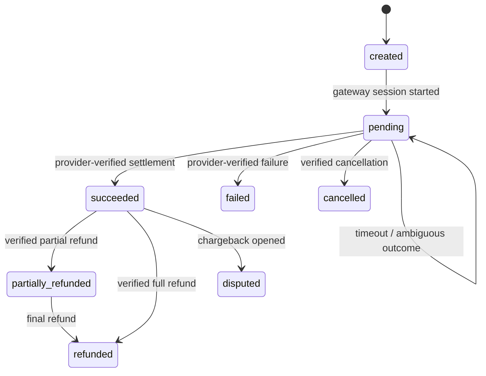

# Reliable payments — scenarios, ACID, concurrency and reconciliation

> **Status:** Current reference. Identical in the v3.1 and v4 packages. Design only; no payment provider is live.

## 1. Why ACID is necessary but not sufficient

ACID applies to the *local database transaction*. External gateway/bank operations live on a different system. There is no distributed ACID transaction across KagoBuild PostgreSQL and a hosted payment provider. Preserve integrity with **idempotency, provider status verification, authoritative server-side webhooks, transactional local fulfillment, and periodic reconciliation**.

## 2. State transitions



No timeout may directly mark a charged payment failed. A paid state must not be downgraded to `pending` by a late webhook. A failure before an external charge may allow another user-initiated attempt using a **new** request idempotency key.

## 3. Lost internet case

1. Client creates a stable `checkoutRequestId` UUID and sends it to the API (not a price). Backend creates or finds matching pending payment intent, and returns its immutable ID.
2. Backend creates or recovers a provider checkout with provider-supported idempotency/reference, safely persists its reference, and returns hosted payment URL/session.
3. User approves payment, but client goes offline. Provider may already charge; the UI knows nothing yet.
4. Provider sends a signed webhook to the KagoBuild backend independent of the customer's connection. Backend verifies signature and, where needed, calls verify-by-reference; compares amount/currency/merchant/order; deduplicates event.
5. Database transaction locks the intent, applies allowed change, grants the relevant entitlement **once** with unique paid intent key, writes outbox. Commit; webhook acknowledged. Admin dashboards can rebuild from this event history.
6. User reconnects. UI calls `GET /api/payments/:id` to show known authoritative status. If still pending, show pending and ask backend to reconcile; don't automatically create another charge.
7. Independently, scheduled reconciliation compares pending/unmatched/chargeback/refund provider records to local records, and produces alerts for manual review where necessary.

## 4. Concurrency cases and safeguards

| Situation | Safeguard | Expected result |
|---|---|---|
| Same checkout request retried | UNIQUE `(user_id, idempotency_key)` plus request fingerprint | Same intent; reject different request content with same key |
| Provider retries webhook | UNIQUE `(provider, provider_event_id)` + entitlement `UNIQUE(payment_id)` | One semantic payment application/entitlement |
| Webhook and reconciliation update concurrently | Row lock on payment, allowed state transitions, short transaction | At most one entitlement; no stale status overwrite |
| User disconnects while bank succeeds | Provider event / verify-by-reference and polling on reconnect | Payment ultimately resolved without blind second charge |
| Two different purchase requests same subscription | App-specific active-subscription lock/invariant and policy | Second request blocked or explicitly treated as renewal/upgrade |
| Refund request after capture | External refund with own idempotency, tracking and approval | Distinct refund event, not a local DB rollback |
| Hypothetical wallet withdraw R100 twice from R150 | Atomic conditional balance update or serializable ledger transaction; unique withdrawal ID | At most one succeeds; never allow negative available balance |

For wallet teaching example, under `READ COMMITTED`:

```sql
UPDATE wallet_balances
SET available_cents = available_cents - 10000
WHERE wallet_id = $1 AND available_cents >= 10000
RETURNING available_cents;
-- if 0 rows: insufficient available funds; record failed attempt as appropriate
```

**This is illustrative, not a production wallet implementation.** A production wallet needs a robust double-entry ledger, independent immutable posting records, dispute handling, audits and relevant regulatory review.

## 5. Test checklist before going live

- Duplicate identical webhook, unknown provider reference, invalid HMAC, payload mismatch, provider verify API outage, replayed/late webhook, out-of-order refund.
- Simulate client connection drop before redirect, during approval, after provider charge and before confirmation; do not create another payment on refresh.
- Parallel checkout with same key and conflicting details; parallel webhook and reconciliation execution.
- Database crash between webhook receipt and commit; between commit and webhook HTTP 200; retry must converge on one entitlement.
- Provider settlement report compared to local captured/refunded totals daily; flag any discrepancies.
- Concurrency isolation tests using real PostgreSQL, not merely SQLite.
