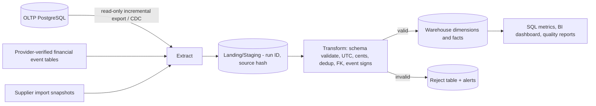

# KagoBuild — data warehouse and ETL blueprint

> **Status:** Current reference. Identical in the v3.1 and v4 packages. Describes the synthetic-data ETL demo (`warehouse/` in the v4 package) and the production path.

## 1. Operational DB vs. data warehouse

Operational PostgreSQL (OLTP) processes requests and payment events with short, consistent writes. The **separate analytics database (OLAP-style star schema)** answers strategic and reporting questions without locking or overloading payment transactions. Never use an analytical query to grant user access or reconcile a payment.

Example questions:
- How many customers converted from Free to paid by registration region?
- How many AI generations succeeded and what is p95 processing time?
- What is the net amount captured less refunds, grouped by day/currency/provider?
- Which materials and suppliers provide the lowest *dated* offers in each region?
- How many saved projects generated a quotation and later converted to a paid plan?

## 2. Data flow

**Demo**: `warehouse/etl.py` extracts eight **synthetic** CSV sources, stores keyed raw input in `stage_rows`, validates fields with an allowlist, transforms timestamps to UTC, checks references, and loads dimension and fact tables. On repeat runs it detects unchanged source rows by SHA-256 hash and skips loaded records. Rejects are isolated in a quarantine table with run ID and reason; internal unexpected failures trigger transaction rollback. The demo uses full CSV snapshot scanning (hash-based incremental change loading), **not real CDC or a streaming connector**.

**Production**: switch extraction to a read-only PostgreSQL replica/CDC stream or carefully controlled incremental views; use transactionally consistent snapshots or source change metadata, replayable offsets, late-arrival handling, deletion/tombstone semantics and durable orchestration. Separate warehouse credentials, schemas, compute, backups, and performance tuning. Never use production card details or secrets in exports. Incremental checkpoint must advance only *after* destination commit.

## 3. Star schema with facts and dimensions

Facts are events or measurable business processes. Dimensions are descriptive lookup entities.

| Warehouse table | Grain (one row represents) | Primary measure / use |
|---|---|---|
| `dim_date` | One UTC calendar day | Grouping by day/month/quarter |
| `dim_user` | One anonymised or pseudonymised platform user | Acquisition region/channel, no email or full name |
| `dim_region` | One operating region | Supplier geography and adoption |
| `dim_plan` | One subscription plan code | Paid-tier conversion |
| `dim_supplier` | One supplier code | Source comparisons |
| `dim_material` | One canonical material SKU | Material pricing |
| `fact_projects` | One project, latest operational snapshot | Project status and activity |
| `fact_subscriptions` | One subscription, latest operational snapshot | Active/pending subscription counts |
| `fact_payments` | One payment intent, latest operational snapshot | Success/failure and pending exposure; amount is **not** automatically revenue |
| `fact_payment_events` | One **immutable verified financial event** | Signed delta: captures positive, refunds/chargebacks negative |
| `fact_ai_generations` | One plan generation request | Processing time, completion rate |
| `fact_estimates` | One estimate version | Estimated construction value, not KagoBuild revenue |
| `fact_supplier_prices` | One supplier/material/region/time price snapshot | Price trends and supplier comparison |

Relationship example: `fact_payments.user_key -> dim_user.user_key` and `fact_payment_events.payment_id -> fact_payments.payment_id`.

This starter uses **SCD Type 1** user/channel/plan dimension updates; it does **not** reconstruct past user-region changes or historical price catalogue labels. Later, add SCD Type 2 (`effective_from`, `effective_to`, `is_current`) to dimensions where historical attribution matters. Event/snapshot facts already preserve transaction history more naturally than dimension attributes.

## 4. ETL stages in detail

1. **Extract** — pull source rows from approved operational exports, not the public frontend. Validate exact CSV columns; use operational source identifiers.
2. **Land/stage** — store source/key, canonical payload, SHA-256 digest, extract run and audit timestamps. Safe repeated loads use the same natural keys.
3. **Transform** — validate non-null references, IDs, allowed statuses, timezone-aware timestamps, valid integer currency minor units, positive captures and negative refunds; normalise UTC; reject orphaned rows or mutated financial event IDs.
4. **Load dimensions** — users, date, plan, region, supplier and material. Resolve surrogate keys.
5. **Load facts** — projects, subscriptions, payment snapshots, verified financial events, plan-generation jobs, estimates and supplier snapshots. Upsert mutable snapshots; do not rewrite immutable payment events.
6. **Quality / reconciliation** — count source/staging/loaded/rejected; verify referential integrity, data freshness, duplicate rates, capture/refund reconciliation, payment-provider settlement differences. Alert on rejected money events.
7. **Publish** — read-only analytics queries and views, with restricted access. BI queries should use dated event flows and snapshots explicitly.
8. **Orchestrate** — schedule or trigger on source changes; handle retries, backfills, replay, retention, and alerting. Never mark a batch fully completed until the local commit succeeds.

## 5. Cash metrics are not accounting revenue

Do **not** sum all `fact_payments.amount_cents`: that includes failed and pending attempts, and may double-count partially captured/refunded payments. For a simple **net provider cash movement** proxy, sum signed verified `fact_payment_events.delta_cents` by currency. This figure is **not accounting-recognised revenue**, net of gateway fees, tax, subscription service-period accruals or supplier payouts. Those need dedicated settlement, revenue-recognition, tax and payout facts with finance-approved definitions.

For example, a R399 capture creates `+39900` cents. A later R149 refund is a separate `-14900` cents event. The current payment status may be `refunded`, but its history remains visible. A repeated webhook must not insert a second financial fact. Refunds exceeding prior captured amounts are quarantined. Late events must be recovered through replay/backfill.

## 6. Data quality tests and operating controls

- Required columns and exact allowlist: prevents accidental PII/card columns entering the stage.
- Unique natural source IDs; duplicate IDs within CSV cause extraction failure and transaction rollback.
- Source hash and upsert: reruns do not double-count business events.
- Immutable event body for an existing event ID; corrections require a separate signed adjustment event.
- Payment owner matches subscription owner; payment amount/provider identity cannot silently change.
- UTC timestamps, nonnegative prices and AI execution duration, signed capture/refund rules.
- Foreign key checks and quarantine on missing parent.
- Quarantine manual review for reconciliation events; no silent business correction.

**Not built in demo:** real connector/CDC streaming, gateway signature verification, live source DB, full SCD2, multi-currency FX conversion, hard deletes / privacy deletion workflows, data masking at scale, production access grants, financial general ledger or BI service. These are production work items.

## 7. Data confidentiality and retention

Use a purpose-limited, pseudonymised analytics user ID; no customer email, name, passwords, tokens, card details, raw checkout payloads or construction-site street addresses in the warehouse. Restrict admin analytics by role and export purpose. Implement minimised retention and deletion/erasure propagation appropriate to South African POPIA, subject to financial-record retention obligations.

## 8. Recommended production build order

- Finalise operational schema, payment provider, plans and price SKUs, and verified event lifecycle.
- Add export or CDC views with privacy projection and explicit update sequence/watermarks.
- Deploy warehouse schema in separate PostgreSQL DB, port pipeline SQL and source adapter, provision read-only source user.
- Run backfill; test CDC and reconciliation against provider settlement and app financial reports.
- Add orchestration, retries, failure alerts and daily finance sign-off, then dashboard models.

## 9. References

- https://learn.microsoft.com/en-us/power-bi/guidance/star-schema
- https://www.postgresql.org/docs/current/transaction-iso.html
- https://paystack.com/docs/payments/webhooks/
