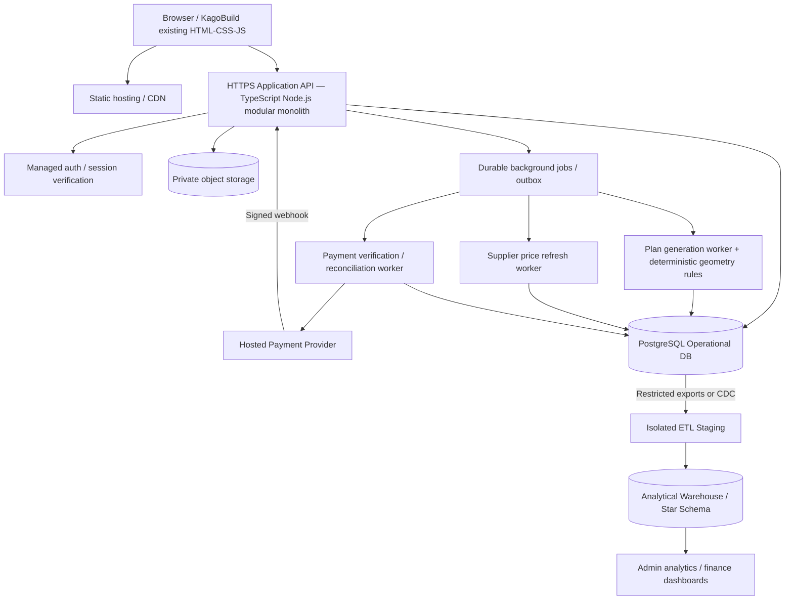

# KagoBuild — recommended system design v2

> **Archived:** earlier "system design v2" notes shipped inside the v3.1 package. **Superseded by** [System design v4](../02-architecture/01-system-design-v4.md).

## 0. Ground truth and decisions

Reviewed the uploaded `KagoBuild.zip`: HTML/CSS/JS pages for plans, estimator, projects, premium, supplier marketplace, admin finance; proposed docs; `server.js`, `package.json`, and most backend controllers/jobs are empty. The pre-existing docs are **proposals**, not production traffic requirements. Premium and admin pages show inconsistent illustrative subscription pricing. No live payment processor is configured in the inspected pages. Nothing below claims otherwise.

**Product scope:** concept floor plans, estimating and supplier prices, saved projects, paid subscriptions and later supplier order/commission functionality. No wallet, banking functionality or customer withdrawal feature is evidenced in the present MVP; withdrawal below is a concurrency teaching scenario and a future optional domain.

**Decisions to confirm before implementation:** real subscription SKUs/prices/periods, payment gateway and supported payment methods, whether KagoBuild accepts payments *for suppliers* or only bills for its own subscriptions, refund policy, supplier price-feed rights, actual data residency, finance/accounting requirements, and production load targets.

## 1. Recommended deployment architecture



Begin with one application backend and separate worker process as needed, not independently deployed microservices everywhere. A queue is warranted for slow/retryable tasks; the transactional outbox prevents loss of locally recorded work. Payment provider external calls must not be performed while holding PostgreSQL transaction locks.

### Recommended implementation choices

| Concern | Start with | Reason / replacement trigger |
|---|---|---|
| Browser UI | Existing HTML/CSS/JS, progressively refactor to modules | Preserve existing site and avoid migration cost. React is optional, not required. |
| Main API | Node.js + TypeScript + Fastify or Express | One coherent backend, typed contracts, modular code. |
| Primary transactional DB | PostgreSQL | Payments, subscriptions, estimates, concurrency and referential integrity. |
| Auth | Managed auth (e.g., Supabase Auth) | Avoid implementing password reset/token management. Verify sessions server-side. |
| File storage | S3-compatible private bucket | Store generated PDF, SVG and export bytes; DB stores metadata and ACL. |
| AI | Provider adapter + deterministic constraints solver | LLM proposes structured specs; geometry, takeoff and validation are explicit code. |
| Expensive async work | Durable worker; queue after operational MVP | Cannot allow browser connection loss to cancel server jobs. |
| Payment gateway | SA-supported hosted checkout gateway, to be selected | Provider is source of truth for settled events; minimize PCI scope. |
| Warehouse | Separate Postgres analytical DB for initial scale | Read-only ingestion from OLTP, star schema; graduate to managed OLAP as demand grows. |
| Monitoring | Structured logs, metrics, tracing, audit and alerting | Especially provider events, subscription activation, reconciliation, job backlogs. |

### API and code boundaries

```
api/src/
  modules/identity/     auth, project-scoped access, RBAC
  modules/projects/     project CRUD, plan versions
  modules/ai/           generation requests and job status
  modules/catalogue/    materials and canonical SKUs
  modules/pricing/      supplier snapshots and price validity
  modules/estimates/    BOQ, deterministic pricing, immutable quotes
  modules/billing/      subscription plans, payment intents, entitlements
  modules/payments/     gateway adapter, verified webhook inbox, reconciliation
  modules/audit/        privileged activity and trace identifiers
  infrastructure/       pg, storage, durable outbox, worker scheduling
```

Suggested API contracts: `POST /api/projects`, `GET /api/projects/:id`, `POST /api/projects/:id/plans`, `GET /api/jobs/:jobId`, `POST /api/projects/:id/estimates`, `POST /api/checkout-sessions` (requires authenticated user + idempotency key), `GET /api/payments/:id`, `POST /api/payments/provider-webhook`, `GET /api/account/entitlements`. Users can access only their own resources or appropriately shared team resources; an administrator's frontend doesn't confer admin privileges by itself.

## 2. Payment data and state design

- Plans and prices come from the **server's** catalogue, not the browser. Store a price snapshot and currency in minor units, e.g. ZAR cents.
- Payment intent initially `created` or `pending`; external provider reference linked when established. The idempotency key is unique **per user and operation**; use same key across timeouts/retries of the same operation and a new key for a new real intent.
- All provider updates undergo signature verification AND server-to-provider verification whenever appropriate, including expected amount/currency/merchant reference. Signature verification must use unmodified raw bytes per provider documentation.
- Persist unique provider event ID and provider transaction reference. Duplicate/out-of-order events must not double grant access or revert a terminal financial event incorrectly.
- Within one short PostgreSQL transaction: lock affected payment row, apply valid transition, insert single entitlement if appropriate, write audit/outbox, commit. Only *after* commit acknowledge accepted webhook. Acknowledge duplicate valid events also; reject invalid signatures.
- If provider is down or status is unclear, hold the payment in an **unknown/pending** state; reconcile later. Never auto-run a new charge to resolve ambiguity.
- For refunds, record a **new reverse financial event** and update access according to an explicit refund policy. Database ROLLBACK cannot undo a provider's already captured charge.
- For a future supplier settlement or wallet feature use a proper double-entry ledger with a posting invariant, not a mutable balance updated from the browser. Consider compliance and gateway marketplace support before introducing payouts.

## 3. Concurrency and transaction boundaries

`READ COMMITTED` plus `SELECT ... FOR UPDATE`, unique constraints and conditional updates are appropriate for many simple state transitions. Use `SERIALIZABLE` **selectively** where invariants span multiple changing rows and retry entire database transactions on PostgreSQL SQLSTATE `40001`. Handle deadlocks (`40P01`) by bounded retry, and deduplicate at the provider boundary separately. Don't set the whole site to SERIALIZABLE without testing contention.

Example: two browser tabs click Pay simultaneously. An identical logical checkout idempotency key maps to one intent via `UNIQUE(user_id, idempotency_key)`. A reused key with changed plan/amount must be rejected. Separate keys can still cause two actual purchases; guard active subscription purchase according to a server-side business rule and reconcile accidental duplicates via policy. The key alone is not a guarantee against all double charges.

## 4. Capacity and failure strategy

- Start with one API deployment, managed relational database and isolated worker. Validate with measured load, not 1M assumed users.
- SLOs and limits are *targets to test*, not guarantees: successful verified payments never activate entitlement more than once; daily reconciliation of all uncertain charges; monitored webhook latency; controlled AI backlog; secure user isolation.
- API horizontally scales after load tests; workers scale by backlog; supplier feeds use backoff and stored last-seen timestamps; browser uses polling to resume lost AI jobs/payments.
- DB backup/PITR and routine restore drills; operational on-call alerts for unmatched payments, duplicate business actions, failed outbox publishing, delayed warehouse loads.
- CDN for static files; caching only for public/immutable plan catalogues and supplier prices with freshness labels, never raw private auth or payment status.
- Costs and complexity should grow with observed need. Microservices and distributed warehouses remain later options.

## 5. Threat and privacy controls

HTTPS, strong auth, secure session cookies, server-enforced access control, object ACLs, DB constraints, secret rotation, protected provider keys, rate limiting, audit logs, least-privilege warehouse readers, encrypted backups, minimal retention and consent-purpose review. Only aggregated/sanitised fields needed for analytics flow into the warehouse. Do not send card PAN/CVV to KagoBuild's own services. Use a hosted provider UI.

## 6. References

- PostgreSQL transaction isolation: https://www.postgresql.org/docs/current/transaction-iso.html
- Paystack webhooks: https://paystack.com/docs/payments/webhooks/
- Paystack transaction verification: https://paystack.com/docs/payments/verify-payments/
- Dimensional star schemas: https://learn.microsoft.com/en-us/power-bi/guidance/star-schema
