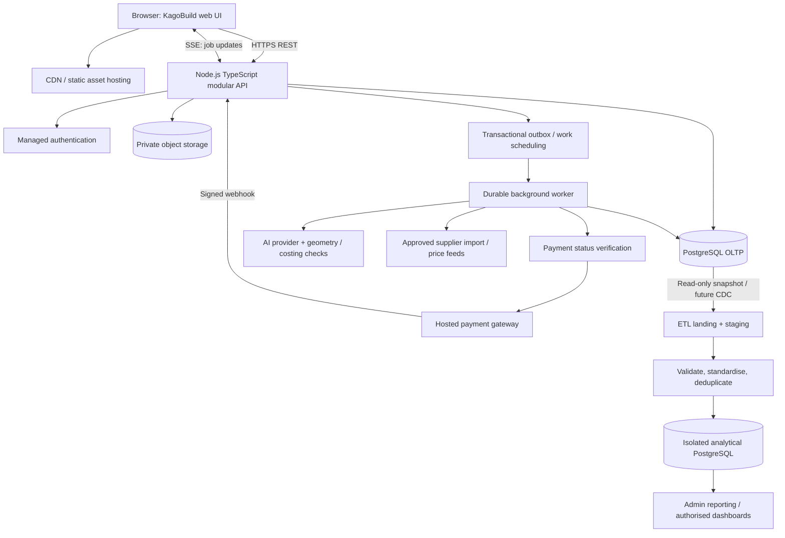
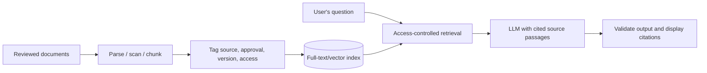
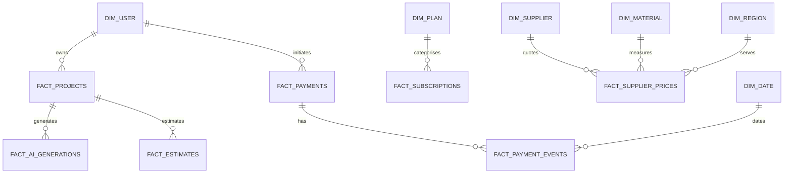
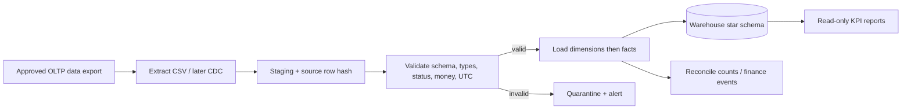

# KagoBuild — Proposed System Design, API Strategy, Security and Data Warehouse

> **Archived:** v3.1 master design (kept for its reasoning and reading list). **Superseded by** [System design v4](../02-architecture/01-system-design-v4.md). The v3.1 payment and warehouse documents were byte-identical to the v4 copies and are not duplicated here.

**Version:** 3.0 | **Date:** 2 November 2026 | **Status:** Design proposal and learning reference — not a deployed implementation

> **Purpose.** Design KagoBuild from its business needs rather than copy the architecture or one-million-user assumptions in its older documents. The companion package includes an **executable synthetic-data ETL demonstration**. None of the payment-processing, security or AI components described below should be represented as implemented in the original website.

## Executive decision

**Recommended architecture:** a three-tier web application with a **TypeScript/Node.js modular-monolith API**, **PostgreSQL transactional database**, **managed authentication**, private object storage, and **separate durable workers** for AI and other long-running operations. Use **REST** for core browser functionality, **verified provider webhooks** for external payment events and **Server-Sent Events (SSE)** for AI job updates. Add **WebSockets only for a real-time chat/collaboration requirement**. Start analytics in a **separate PostgreSQL star-schema warehouse** fed by an auditable, incremental **ETL** pipeline. Use **RBAC + record ownership** as part of access control; consider **RAG** later for approved building information.

**Why not microservices immediately?** KagoBuild's implementation is at an early stage; separate services introduce network failure modes, multiple deployments, distributed tracing and cross-service data consistency before proven benefits. A modular monolith has clear internal boundaries that can be extracted later based on measured constraints, not speculative traffic.

### 1. Verified current state vs. design proposal

Based on the uploaded `KagoBuild.zip` (inspected November 2026):

| Observed in uploaded project | Design implication |
|---|---|
| HTML/CSS/JavaScript pages for projects, AI house plans, estimator, supplier marketplace, premium and admin | Preserve current UI initially; replace demonstration data through a backend API. |
| `server.js`, `package.json`, most `backend/` code files empty | Backend and database are not operational yet. |
| Existing `docs/06-system-design.md` and `docs/08-scalability-1m-users.md` | Earlier architecture and scale goals are **user proposals**, not verified production requirements. |
| Premium and admin finance interfaces | Subscription/payments feature is intended, but no live integrated processor is established by the inspected code. |
| No operational user/payments database to extract from | Warehousing demonstration must use **synthetic** data until there is a trusted operational source. |

**Open product decisions:** whether KagoBuild charges only for its own subscriptions or also holds supplier payments; confirmed price plans and durations; refund/chargeback policy; provider/merchant onboarding; supplier price-feed permissions; who can approve building plans; target service-level objectives, realistic user and transaction volumes, and finance/privacy retention rules. These are not to be invented.

## 2. Architecture: how components communicate



**Trust boundaries:** The browser is untrusted and never chooses the amount to charge or the role it holds. All sensitive operations pass through backend validation and authorization. Only the payment provider can establish external payment outcomes. Warehouse connectors have read-only access to limited fields, and warehouse roles cannot modify the operational database.

**Main modules in one deployment:** `identity`, `projects`, `plan-generation`, `materials`, `suppliers`, `estimates`, `billing`, `payments`, `admin`, `audit`, `notifications`. A separate worker **process** is acceptable without splitting every module into a microservice. Heavy AI provider calls never hold open a database transaction.

### 2.1 Technology recommendations and reasons

| Concern | Initial selection | Why, and when to change |
|---|---|---|
| Web frontend | Existing HTML/CSS/JS | Smallest migration; a React rewrite is optional and not a system-design prerequisite. |
| HTTP API | Node.js + TypeScript + Fastify or Express | Clear middleware, validation, OpenAPI support, hiring/developer familiarity; choose one consistently. |
| OLTP database | PostgreSQL (managed instance) | Relational integrity, ACID, row locks, unique constraints, transactional event/outbox updates. JSONB can hold flexible design specs. |
| Authentication | Managed identity such as Supabase Auth | Avoid implementing password hashing, token issuance and recovery flows from scratch. Server must still verify claims and authorization. |
| Hosted checkout | South African-supported provider with secure checkout, signature-verified webhooks and verify-by-reference API | Keeps card information out of KagoBuild and permits reconciliation. Shortlist (not an integration): Paystack, Yoco, Peach Payments; verify current commercial fit and supported features. |
| Background jobs | Postgres job/outbox first, or Redis + BullMQ for higher job volume | Reconcile, retry and process AI without depending on one browser connection. Persistent jobs are critical; Redis is a scaling choice, not a correctness substitute. |
| AI concept plans | Provider adapter + deterministic geometry/constraint engine | Use model for interpretation/ideas, code for measurable quantities, constraints and traceable calculations. |
| Private files | Managed S3-compatible bucket | Plans, drawings, supplier documents and downloadable PDFs, accessed through scoped signed URLs. |
| Data warehouse | Separate PostgreSQL warehouse initially | Simple, affordable learning-friendly star schema; move to an analytical engine when volumes and workload justify it. |
| Retrieval (optional) | PostgreSQL full-text, then pgvector if needed | Approved technical knowledge base for AI responses with source references and permissions. |
| Observability | Structured logs, metrics, tracing and audit events | Detect wrong payment states, expensive AI traffic and broken access control. |

## 3. Which API style belongs where?

The terms REST, GraphQL, webhook, SSE, WebSocket and gRPC are **not sequential upgrade levels**: different approaches may coexist.

| Style | Mechanism | KagoBuild decision | Important trade-off |
|---|---|---|---|
| **REST** | Client requests a versioned resource URL using HTTP verbs, e.g. `GET /api/v1/projects/{id}` | **Primary public API from day one.** | Stateless requests can still use a persistent database and authenticated sessions. Avoid many tiny requests via purpose-built aggregate endpoints. |
| **GraphQL** | Client requests specific fields through a query schema | **Defer** until complex dashboards require independently composed views. | One request can reduce round trips, but resolvers can cause N+1 queries; protect query depth, cost, introspection policies and authorization. It is not automatically faster. |
| **Webhooks** | Provider calls a server endpoint when an event happens | **Required for hosted payments.** | Do not trust a webhook blindly: verify cryptographic signature from raw body, deduplicate, validate related merchant/amount, and retry safely. Webhooks can be delayed or missed. |
| **SSE** | One-way event stream from server to browser | **Preferred for AI-generation progress.** | Browser can reconnect; authorize event streams, use event IDs/replay or fetch status on reconnect. Built-in `EventSource` has header/cookie constraints; use secure same-origin session cookies or a suitable authenticated streaming method. |
| **WebSockets** | Persistent two-way connection | **Only for support chat, multi-user plan editing or live collaboration.** | Authenticate handshake AND authorize each message; handle state, reconnection, broadcasting and scaling. Ordinary HTTP is easier for messages that do not need instant duplex delivery. |
| **gRPC** | Typed RPC with Protocol Buffers, commonly over HTTP/2 | **Internal services only if extracted later.** | Good contracts and efficient binary transport, but never promise a fixed 2× speed-up; adds tooling and browser integration complexity. |

### 3.1 Proposed REST resources (examples, not deployed routes)

| Method + path | Purpose | Authentication / permission |
|---|---|---|
| `POST /api/v1/projects` | Create project | Signed-in `project:create` |
| `GET /api/v1/projects/{projectId}` | Read project | Owner, authorised collaborator, or appropriately scoped admin |
| `PATCH /api/v1/projects/{projectId}` | Change project fields | Project edit permission + optimistic concurrency version |
| `POST /api/v1/projects/{projectId}/generations` | Start AI concept generation | Owner/editor, quota and budget checks |
| `GET /api/v1/generations/{jobId}` | Get durable current job state | Owner or permitted collaborator |
| `GET /api/v1/generations/{jobId}/events` | SSE progress with `Last-Event-ID` support | Same project access check; secure stream authentication |
| `POST /api/v1/projects/{projectId}/estimates` | Produce versioned cost estimate | Project access, validated specification |
| `GET /api/v1/materials?region=...` | Public/authorised catalogue results | Auth by sensitivity; response size capped |
| `GET /api/v1/suppliers?region=...` | Supplier catalogue | Public read or signed-in depending on business rules |
| `POST /api/v1/billing/checkout-sessions` | Start hosted checkout | Logged-in account; `Idempotency-Key` required |
| `GET /api/v1/billing/payments/{paymentId}` | Recover outcome after connection loss | Own payment or finance permission |
| `GET /api/v1/me/entitlements` | Check premium access | Signed-in current user |
| `POST /webhooks/v1/payments/{provider}` | Receive provider events | **Provider signature**, not user bearer auth; endpoint publicly routable with protections |
| `GET /api/v1/admin/analytics/summary` | Admin dashboard from warehouse | `analytics:read` and appropriate organisation scope |

**Example request and response:**

```http
POST /api/v1/billing/checkout-sessions HTTP/1.1
Authorization: Bearer <short-lived-token>
Idempotency-Key: <client-stable-uuid-for-this-checkout>
Content-Type: application/json

{"planCode":"premium-monthly"}
```

Backend looks up **server-controlled** price and currency; never accepts a client-supplied amount or trusted status. Example response:

```json
{"paymentId":"<opaque-id>","status":"pending","checkoutUrl":"<hosted-provider-url>"}
```

Use `201 Created` for a newly created intent, `200 OK` for a safe replay, `202 Accepted` for an asynchronous operation, `409 Conflict` for incompatible idempotency-key reuse and `422 Unprocessable Content` for semantically invalid input. API responses must carry an opaque correlation ID; no stack traces or secrets.

### 3.2 Example SSE protocol

```text
GET /api/v1/generations/{jobId}/events
Content-Type: text/event-stream

id: 301
event: progress
data: {"jobId":"<id>","status":"running","percent":65}

id: 302
event: completed
data: {"jobId":"<id>","status":"succeeded"}
```

Use actual progress only where measurable; otherwise say `queued`, `running` or `completed`, not invented percentages. SSE delivery is not the durable source of truth: after a reconnect, the frontend always checks `GET /api/v1/generations/{jobId}`. Do not stream other users' events. Proxy buffering/timeouts and heartbeat events require configuration.

## 4. Reliable financial transactions: ACID, concurrent requests and offline recovery

### 4.1 What ACID means here

- **Atomicity:** the *local* successful-payment update, entitlement grant and outbox event commit together, or roll back together.
- **Consistency:** money must use integer minor units, foreign keys must match, and one successful payment cannot activate the same entitlement twice.
- **Isolation:** transactions coordinate concurrent webhook, checkout and reconciliation operations with locks, constraints and bounded retries.
- **Durability:** once committed, payment state survives process failure subject to DB durability/backups.

**ACID does not undo an external bank charge.** A refund is a distinct external action and a new financial record. An `HTTP 500`, browser timeout or lost Wi-Fi does **not** prove the payment failed.

### 4.2 Lost-internet payment sequence

```mermaid
sequenceDiagram
  participant User as Browser
  participant App as KagoBuild API
  participant DB as PostgreSQL
  participant PSP as Payment provider
  User->>App: POST checkout + Idempotency-Key K
  App->>DB: Insert/find payment intent (K unique per owner)
  App->>PSP: Create checkout with unique merchant reference
  PSP-->>App: Hosted checkout URL
  App-->>User: paymentId, redirect URL
  User->>PSP: Approve payment
  Note over User: User loses connectivity
  PSP->>App: Signed webhook or status changes remotely
  App->>PSP: Verify authoritative details when needed
  App->>DB: BEGIN; lock intent; write event; grant once; outbox; COMMIT
  App-->>PSP: 2xx after durable acceptance
  Note over User: Browser reconnects
  User->>App: GET /billing/payments/{id}
  App-->>User: Current state or pending/unknown
```

1. **Before checkout:** generate one stable request idempotency key, persist intent and merchant reference safely, and return the same intent for identical retries. A reused key with a different product/price fingerprint is rejected.
2. **During provider processing:** KagoBuild does **not** hold an SQL transaction lock while waiting on the external provider. Use server-side provider adapters, timeouts and retry-safe merchant references.
3. **Provider notification:** verify signature from exact raw request bytes, compare expected amount/currency/merchant/reference and deduplicate provider event ID. Some providers send only selected event types; schedule status verification and reconciliation for unresolved payments.
4. **Short database transaction:** `SELECT ... FOR UPDATE` the intent; verify legal state transition; persist financial event, grant entitlement once, write outbox, `COMMIT`. On duplicate webhook, return success without repeating the grant.
5. **On reconnection:** look up the same payment ID; **never automatically start a second charge** because the last response was lost. Only allow a new attempt when provider and backend confirm the previous attempt's terminal failure/abandonment under the documented business rule.
6. **Reconciliation:** periodically compare unresolved intents and provider payment/refund reports. Flag unlinked charges, amounts that differ, provider outages, missed webhook delivery and disputed/refunded charges for review.

**Source of truth:** the payment provider establishes external processing state; KagoBuild's verified event history and database determine platform entitlements. The user's frontend return URL is **not** proof of success.

### 4.3 Concurrent-transaction controls

| Race or failure | Guard |
|---|---|
| Same checkout retried by two tabs | `UNIQUE(user_id, idempotency_key)` and stored request fingerprint; identical requests return same payment intent. |
| Two *different* checkout keys for same subscription | Lock subscription/business account; enforce one relevant active pending purchase or explicit upgrade/renewal policy. Idempotency alone doesn't stop two truly different charges. |
| Webhook delivered twice/out of order | `UNIQUE(provider, provider_event_id)`, provider ref index, allowed-state transitions and deduplicated entitlement. |
| Webhook races reconciliation worker | `SELECT ... FOR UPDATE`; same verified state transition and immutable event log; bounded deadlock retries. |
| Customer requests refund twice | Stable refund idempotency key, refund record uniqueness, provider verification and total-refunds-cannot-exceed-captures rule. |
| Supplier stock/last place sold | Conditional updates or row locks in one short transaction, checking affected row count. |
| Hypothetical wallet withdrawals | **Not an MVP requirement.** If ever added, use a proper double-entry ledger, separate holds/available funds, idempotent payouts, reconciliation and legal review, never a single mutable balance field alone. |

PostgreSQL `READ COMMITTED` + row locks/constraints works for many payment updates; use `SERIALIZABLE` for invariants spanning several changing rows and retry SQLSTATE `40001`. Avoid indiscriminately using serializable isolation for all endpoints. Example guarded stock update:

```sql
UPDATE inventory
SET available_quantity = available_quantity - :qty
WHERE sku = :sku AND available_quantity >= :qty
RETURNING available_quantity;
-- zero returned rows means stock could not be reserved
```

### 4.4 Payment state machine and data invariants

`created → pending → succeeded / failed / cancelled`; success may later produce `partially_refunded`, `refunded`, or `disputed` states. A late `pending` message never changes `succeeded` backwards. Store refunded/captured amounts as **separate immutable financial events**, not silent edits to a transaction history.

Production constraints: positive payment amount; ISO currency code; server pricing snapshot; provider reference uniqueness; event ID uniqueness; entitlement unique by payment or economic obligation; audit actor/source; immutable provider event receipts; signed nondecreasing event order where provider offers sequence; reconciliation alert for impossible transitions. Payment provider fees, VAT and recognised subscription revenue require their own finance definitions; do not equate all `succeeded` payment attempts with recognised revenue.

## 5. API security, in practical terms

Apply OWASP API security principles with a **defence-in-depth** model. These are implementation controls, not claims that the original website already passes them.

| ID | Rule / implementation | Verification before launch |
|---|---|---|
| S01 | **Authenticate every protected operation**; separately verify provider signatures for webhooks. Public catalogue or health endpoints are explicit exceptions. | Missing/expired/forged sessions receive 401; unsigned webhook rejected. |
| S02 | **Check object access** for every project, plan, payment, estimate, message, file and SSE stream (BOLA/IDOR prevention). | User A cannot retrieve or modify User B's resource even by guessing IDs. |
| S03 | **RBAC + ownership + least privilege**. UI visibility is not authorization; validate on server, DB and storage. | Supplier cannot invoke admin finance action; support cannot see full provider financial secrets. |
| S04 | **HTTPS only**, HSTS at public edge, authenticated TLS to services where needed; secure cookies. | HTTP redirects/rejected; no mixed content. |
| S05 | **Short-lived access credentials**, refresh-token rotation/session revocation, proper expiration and server-side logout handling. | Revoked/expired sessions do not continue to access API, SSE or WebSocket endpoints beyond documented bounds. |
| S06 | **Password reset:** one-time high-entropy token, **15-minute example TTL** (policy decision), uniform response for unknown emails, rate limits and session invalidation as appropriate. | Expired/reused link fails; account enumeration responses equivalent. |
| S07 | **Validate input with strict schemas:** types, max lengths, amounts, currencies, ranges, UUIDs, enum values, page sizes, MIME/size constraints. | Unexpected fields and malformed payloads rejected. |
| S08 | **Prevent SQL injection/XSS/SSRF:** parametrised SQL, output encoding, CSP, no user-controlled request destination, supplier API allowlists. | Injection strings treated as data, not executable commands. |
| S09 | **CORS allowlist** for browser origins; add CSRF protection for cookie-auth state-changing requests. **CORS does not make an API private** or replace auth: non-browser callers can still reach public endpoints. | Disallowed browser origin denied cross-origin read; unauthenticated direct calls still denied separately. |
| S10 | **Rate-limit and budget-limit** by IP/account/device/action. Tighter quotas for login, resets, checkout and AI; bounded GraphQL complexity if used. | Bot cannot repeatedly trigger expensive AI jobs or reset emails without control. |
| S11 | **Safe errors and minimal responses:** explicit status codes, opaque correlation IDs, allowlisted fields, pagination and page caps. No stack trace, token or PII leakage. | No overexposed email, role claims, payment or admin-only fields. |
| S12 | **Indexes and bounded queries** on owner + updated timestamp, provider refs, payment states, job owner and date; use database query plans. | Measured query p95 under load; no uncontrolled table scans. |
| S13 | **Structured logs and audit trail** with request ID, time, actor ID, route and outcome, not passwords/card data/full tokens. Tamper-resistance and alerting for admin/finance. | Debugging possible without logging secrets. |
| S14 | **Secrets out of code**, least-privilege provider API keys, secret rotation, separate dev/test/prod environments. Never expose service-role keys to browser. | Secret scanner and production credential permission checks pass. |
| S15 | **Version and inventory APIs:** `/api/v1`, OpenAPI specification, documented auth, deprecation policy, remove dead/test endpoints. Validate encoded path segments; don't put secrets in query strings/URLs. | Endpoint inventory matches deployed routes; no accidental debug route. |
| S16 | **Safe deploy and rollback:** build/test in CI, migration compatibility, deploy health checks, feature flags, reversible application release, tested recovery backups. | Previous application version deployable; database migration rollback/forward plan tested. |
| S17 | **Uploads and private downloads:** scan and validate uploads, object-level storage ACLs, signed URLs with short expiry, file retention and deletion propagation. | Guessing bucket URLs does not disclose private plans. |
| S18 | **Dependency/AI/provider security:** lock dependencies, dependency scanning, validate provider response contracts, prompt-injection controls, egress limits and circuit breakers. | Adversarial and vendor-outage tests pass. |

**URLs and brackets:** API documentation may use `{projectId}` as a placeholder; actual callers put a validated encoded identifier in the path (e.g., `/api/v1/projects/123...`), not literal braces. Reject malformed path encodings, traversal and ambiguous decoded routes. Never use URLs for access tokens or password-reset tokens beyond the controlled, short-lived reset flow.

**Browser session choice:** for a web frontend, `Secure`, `HttpOnly`, appropriately configured `SameSite` cookies plus CSRF protection are often easier to protect than long-lived bearer tokens in localStorage. Manage session rotation/logout and secure SSE/websocket authentication explicitly. Actual TTLs and cookie domains depend on the hosting design.

### 5.1 RBAC — the access-control system

**RBAC** means *Role-Based Access Control*: a user gets permissions because of a verified role. KagoBuild also needs **resource ownership/relationship checks** (sometimes called ABAC): being a `customer` does not grant access to every customer's projects.

| Role | Read own projects | Modify own projects | Maintain own supplier listings | View limited support records | View finance / refunds | Manage users/roles |
|---|---|---|---|---|---|---|
| Visitor | No | No | No | No | No | No |
| Customer | Yes | Yes | No | No | No | No |
| Project collaborator | Shared only | By invitation | No | No | No | No |
| Supplier | No, unless separately invited | No, unless separately invited | Yes | No | Their settlement records only if enabled | No |
| Support agent | By case-specific grant, minimal | No by default | No | Yes, case-scoped | Minimal status only | No |
| Finance staff | Only if job requires | No | No | No | Scoped finance operations with approval | No |
| Administrator | Logged, policy-scoped | Logged, policy-scoped | Policy-scoped | Policy-scoped | Not automatically payment-provider superuser | Scoped admin operations |

Implement `roles`, `permissions`, `role_permissions`, `user_roles`, `project_members`, and audit logs; enforce default-deny. Consider multi-factor authentication for admin/finance, separation of duties and dual approval for high-impact refunds. If exposing Supabase database directly, design and test Row Level Security policies; if using a privileged backend database connection, server authorization remains mandatory even if RLS is in place.

### 5.2 RAG — optional AI knowledge retrieval

**RAG** means *Retrieval-Augmented Generation*: before the AI answers a building question, the system retrieves passages from an **approved and legally available** knowledge base (building requirements, supplier specifications, building-material guidance) and provides them as context.



RAG can reduce unsupported answers but **does not certify** building codes, soil design, structural adequacy or legal compliance. Use real document versions, source dates, page citations, applicable jurisdictions, access filtering, prompt-injection defenses and human engineering review. Do not ingest copyrighted standards without rights; don't let retrieved documents issue instructions to AI tools or initiate payments. RAG is a **later feature**, not part of the payment critical path.

> Interpreting the spoken phrase **“rack system”**: this document includes both **RBAC** (permissions) and **RAG** (AI retrieval), since either may be what you intended. A physical server rack is not recommended for the MVP; managed cloud hosting is simpler.

## 6. Data model: operational database versus data warehouse

**OLTP (online transaction processing)** answers “what is the current payment status?” and supports frequent short writes and reads. **OLAP/warehouse** answers “how many payments, project generations and material price changes occurred across the last three months?” using read-heavy aggregations. The warehouse must not grant user entitlements and must not become the payment authority.

The companion `database/operational_postgres.sql` models profiles, projects, plan catalogue, subscriptions, payment intents, immutable provider events, refund requests, entitlements and an outbox. It is a **schema starter**, not complete production RLS/ledger/gateway code.

### 6.1 Warehouse design: star schema



| Table | Grain (exactly one row for...) | Illustrative metrics |
|---|---|---|
| `dim_user` | One pseudonymised user | Signup channel, region |
| `dim_date` | One UTC date | Date, month, year |
| `dim_region` | One canonical region | Geographic comparisons |
| `dim_plan` | One subscription plan code | Product/plan comparisons |
| `dim_supplier` / `dim_material` | One supplier / material SKU | Pricing context |
| `fact_projects` | One project, latest snapshot | Project count, lifecycle status |
| `fact_subscriptions` | One subscription, latest snapshot | Active/past-due counts |
| `fact_payments` | One payment intent, latest snapshot | Pending/succeeded/failed counts, reconciliation exposure |
| `fact_payment_events` | One immutable verified cash event | Signed captured/refunded/chargeback cash movement |
| `fact_ai_generations` | One AI generation request | Generation success rate, processing time |
| `fact_estimates` | One saved estimate/version | Estimated build value (NOT KagoBuild revenue) |
| `fact_supplier_prices` | One supplier-material-region-price timestamp snapshot | Price trends, cheapest eligible price |

**Key distinction:** R399 successful capture and subsequent R149 refund create **two event rows**: `+39900` cents and `-14900` cents. Summed cash movements equal **R250**, not R399 and not necessarily accounting revenue. VAT, gateway fees, recognised subscription revenue, refunds and payouts need separately agreed accounting models.

**History model:** dimension Type 1 updates in demo (latest attributes); introduce Type 2 history for dimensions where changes over time matter. Use stable natural keys for deduplication and surrogate keys for dimensions. Timezone-aware timestamps are normalised to UTC; store amounts as integer currency minor units and retain currency.

### 6.2 ETL: extract → transform → load (implemented as a training demo)



1. **Extract:** read approved data from the operational source, ideally a read-only replica, an export or change-data-capture stream. Use source IDs, timestamps/offsets and a consistent snapshot. **Current demo:** local synthetic CSV records only.
2. **Land/stage:** keep the canonical source identity, run ID, content digest and arrival timestamp. Strict allowlist prevents accidental transfer of passwords, full names, card numbers and API secrets.
3. **Transform:** validate required columns, identifiers, money values, ISO-like currency codes, status enums, UTC offsets and parent references. Deduplicate same source IDs; quarantine invalid or contradictory rows.
4. **Load dimensions:** dates/users/plans/regions/suppliers/materials before facts; resolve surrogate keys and handle late-arriving references according to explicit policy.
5. **Load facts:** upsert snapshots; **never rewrite an immutable provider financial event**. Distinguish event date from processing/arrival date.
6. **Reconcile:** compare source, staging, inserted, changed and rejected row counts; check referential integrity and amount/currency; separately reconcile provider settlements against verified financial events.
7. **Publish:** least-privilege read-only views for finance/admin; define metric grain, currency and freshness. Avoid interpreting `fact_payments` sum as revenue.
8. **Schedule/recover:** orchestrator retries idempotently, saves successful watermarks **only after destination commits**, alerts on missed runs, supports replay/backfill and deletion/privacy requirements.

The provided demo is **CSV snapshot ETL with hash-based incremental detection**, not a real-time CDC connector. In production, isolation between operational and warehouse credentials/databases is mandatory. **Do not run analytics directly against the operational primary database under heavy load.**

### 6.3 Warehouse questions KagoBuild can answer

- How many active subscriptions were in each plan last month? (Need date-aligned snapshots and a defined active-at-date rule.)
- How many pending payments remain unresolved by age band, provider and currency?
- What are daily verified net cash movements, excluding unresolved intents?
- Which AI plans failed, how long did generation take, and how did failures vary by plan?
- Which materials experienced the largest supplier price fluctuations in Gauteng?
- How frequently are generated estimates saved or converted into paid subscriptions?

For trustworthy financial reporting, source payment events should be provider-verified and any late provider events or currency conversions handled under finance-owned rules. User data minimisation and retention/deletion controls are required under applicable South African privacy obligations.

### 6.4 Run the working ETL demonstration

Unzip the companion package and, inside its `warehouse/` directory, execute:

```bash
python etl.py --input-dir data --db demo_warehouse.sqlite --report
python etl.py --input-dir data --db demo_warehouse.sqlite --report  # safe rerun, no duplicate facts
python -m unittest discover -s tests -v
```

The included sample dataset is **fully synthetic**. It contains 37 source rows across eight CSV sources; the reference execution produced 4 demo users, 5 payment intents and 6 distinct financial events, with an illustrative **ZAR 698.00 net event cash movement**. This is **not actual KagoBuild revenue**. Seven ETL unit tests pass locally for repeatability, invalid amounts, financial-event immutability and other validation scenarios.

## 7. Reliability, capacity, deployments and observability

### 7.1 Failure recovery rules

| Failure | Required system behaviour |
|---|---|
| Browser drops internet during payment | Payment remains durable in backend/provider. On reconnect query same payment; never charge automatically again. |
| Provider webhook delayed/missed | Verification/reconciliation worker checks status; expose pending until authoritative resolution. |
| DB commit succeeds but webhook acknowledgement fails | Provider retry deduplicated; no double entitlement. |
| DB rolls back during webhook handling | Retry event safely; no entitlement granted from uncommitted data. |
| AI provider fails or times out | Bounded retries with backoff and circuit breakers; durable failure/timeout visible by job ID. |
| Admin deploy fails | Roll back application version using deployment automation and compatible migrations; monitor errors. |
| Primary database unavailable | Fail closed for payments/access changes; restore from backed-up data, avoid guessing payment state. |
| ETL batch fails | No watermark advance, retry from same source inputs, quarantine invalid rows, alert on stale dashboards. |

### 7.2 Scale incrementally using evidence

**Stage A (pilot):** CDN + 1 API service + managed PostgreSQL + managed auth + hosted checkout + isolated AI worker + offline ETL. **Stage B (growth):** horizontal API replicas, Redis-backed queues if required, object CDN, read replicas, cache public catalogues, ETL scheduling and monitoring. **Stage C (proven high scale):** separate a domain service only if it has an independent load/team/reliability boundary; consider specialised OLAP infrastructure and streaming CDC.

**Suggested initial performance goals to measure, not promises:** p95 of routine API reads and writes, checkout initialization error rate, unresolved-payment count and age, time to verify provider events, AI queue age, warehouse data freshness, 99th percentile database query times and rollback recovery time. Publish measurable targets after realistic load testing and risk analysis, not arbitrary claims of one million users.

### 7.3 Delivery stages / acceptance gates

| Phase | Build | Completion evidence |
|---|---|---|
| 1 | Identity, roles/ownership, project CRUD, secure API contracts | User-A/user-B isolation tests; valid/invalid access responses; OpenAPI endpoint inventory. |
| 2 | Materials, supplier catalogue and deterministic estimates | Reference inputs produce reproducible quantities/prices with source dates. |
| 3 | Hosted checkout + ledger-like events, provider webhook, idempotency, reconciliation | Sandbox payment tests, disconnect/retry tests and concurrency tests with real PostgreSQL. |
| 4 | AI plans via job workers + SSE status | Worker crash/replay; reconnect sees durable job and correct owner. |
| 5 | Initial operational exports + isolated ETL warehouse | Backfill, duplicate detection, reconciliation and ETL tests pass. |
| 6 | Optional RAG, WebSockets and GraphQL only with justified use cases | Permission testing, prompt-injection tests and real workload benchmarks. |
| 7 | Production hardening and launch | Secrets/permissions audit, accessibility, observability, restore drill, staged rollout and rollback test. |

## 8. Architecture decisions: what would change our mind?

- **Choose GraphQL** if frontend teams routinely need many diverse compositions of nested data, REST aggregation becomes difficult, and query-cost controls are feasible.
- **Choose WebSockets** if two-way low-latency messaging/collaboration becomes a measured product requirement; SSE remains sufficient for one-way AI progress.
- **Choose gRPC** if independent internal services have defined proto contracts and benchmarks show material gains; it is not a generic scale shortcut.
- **Choose microservices** when separate teams, independent deployments, regulatory boundaries or scaling bottlenecks justify operational complexity.
- **Choose a dedicated analytical database** if PostgreSQL warehouse load, concurrency, retention or BI latency fails measured goals.
- **Choose formal double-entry payments/settlement ledger and regulated architecture** if KagoBuild begins holding customer money, making supplier payouts or supporting withdrawals. Do not silently treat a subscription checkout as a wallet.

## 9. Evidence, references and limits

**Primary project evidence:** uploaded `KagoBuild.zip`, including README, pages, previous proposal docs and unimplemented backend skeleton. Those prior architecture files are **not assumed correct requirements**. **External technical references:**

1. [OWASP API Security Top 10 (2023)](https://api-security.owasp.org/editions/2023/en/0x11-t10/) — authentication, object-level authorization, response properties, inventory and abuse.
2. [OWASP HTML5 / CORS guidance](https://cheatsheetseries.owasp.org/cheatsheets/HTML5_Security_Cheat_Sheet.html) — CORS is not a substitute for access checks.
3. [OWASP Forgot Password Cheat Sheet](https://cheatsheetseries.owasp.org/cheatsheets/Forgot_Password_Cheat_Sheet.html) — reset token and recovery policy.
4. [OWASP RAG Security Cheat Sheet](https://cheatsheetseries.owasp.org/cheatsheets/RAG_Security_Cheat_Sheet.html) — prompt injection and document access boundaries.
5. [PostgreSQL Transaction Isolation](https://www.postgresql.org/docs/current/transaction-iso.html) — locking, isolation and serializable retries.
6. [Paystack Webhooks](https://paystack.com/docs/payments/webhooks/) and [Verify Payments](https://paystack.com/docs/payments/verify-payments/) — **example provider documentation**, not proof of a live KagoBuild integration.
7. [MDN Server-Sent Events](https://developer.mozilla.org/en-US/docs/Web/API/Server-sent_events/Using_server-sent_events) — one-way streaming and browser behaviour.
8. [gRPC Introduction](https://grpc.io/docs/what-is-grpc/introduction/) — type-safe internal RPC.
9. [AWS Transactional Outbox Pattern](https://docs.aws.amazon.com/prescriptive-guidance/latest/cloud-design-patterns/transactional-outbox.html) — avoid unreliable dual-write event publication.
10. [Microsoft Star Schema Guidance](https://learn.microsoft.com/en-us/power-bi/guidance/star-schema) — dimensional modelling.

**Scope disclaimer:** This is an architecture proposal and learning package, **not** live deployment, proof of PCI compliance, a professional structural design, accounting assurance or implementation of hosted checkout. Price feeds and AI reference material require licensing and factual validation. ETL data is synthetic. Real provider sandbox testing, RLS/RBAC enforcement code, operational connectors, production secrets and compliance review are outstanding.

## 10. Recommended system design books and learning path

**Buy first (beginner to intermediate): _System Design Interview – An Insider's Guide, Volume 1_ by Alex Xu.** This is the most practical starting point for the KagoBuild development team. Its worked examples and architecture diagrams cover scaling from zero users, rate limiting, caching, unique identifiers, notifications, and designing systems in a structured manner. Although framed around interviews, the designs can be practised against KagoBuild's actual requirements. Publication: independently published, 2020; print ISBN: **9798664653403**. [Book information and contents](https://www.harvard.com/book/9798664653403). Check edition, shipping and current local retail prices before purchasing.

**Next (intermediate to advanced): _Designing Data-Intensive Applications, 2nd Edition_ by Martin Kleppmann and Chris Riccomini.** This is the most directly relevant deep-dive for KagoBuild's payment reliability, ACID and concurrent transactions, consistency, network partitions, data warehouse/ETL, replication and event processing. Publication: O'Reilly, 2026; paperback ISBN: **9781098119065**. [Publisher book and table of contents](https://www.oreilly.com/library/view/designing-data-intensive-applications/9781098119058/) | [Print edition](https://ingramacademic.com/products/designing-data-intensive-applications-9781098119065). This is denser than the first book, so it is a *second* purchase unless the team is already comfortable with backend and database fundamentals.

### Apply the reading to KagoBuild

| Study sequence | Topic to learn | Apply it to the platform |
|---|---|---|
| 1 | Functional requirements, API boundaries and basic scaling | Draw KagoBuild's frontend → API → database flow and document REST endpoints. |
| 2 | Authentication, authorisation, rate limiting, and cache boundaries | Implement and test user-project ownership checks, API quotas and supplier catalogue caching. |
| 3 | ACID, isolation, unique constraints, retries and idempotency | Implement checkout state transitions and simultaneous-webhook tests in PostgreSQL. |
| 4 | Unreliable networks and asynchronous communication | Simulate checkout disconnection, delayed provider callbacks and AI worker failures. |
| 5 | Batch/stream processing, dimensional modelling and analytics | Advance the ETL warehouse from synthetic inputs to authorised incremental data feeds with reconciliation. |

**Supplemental free references:** [OWASP API Security Top 10](https://owasp.org/API-Security/) for API security, [PostgreSQL transaction isolation](https://www.postgresql.org/docs/current/transaction-iso.html) for concurrency, and [Microsoft star-schema guidance](https://learn.microsoft.com/en-us/power-bi/guidance/star-schema) for dimensional modelling. No book substitutes for reviewing payment-provider documentation, load testing, threat modelling, or real implementation testing.
